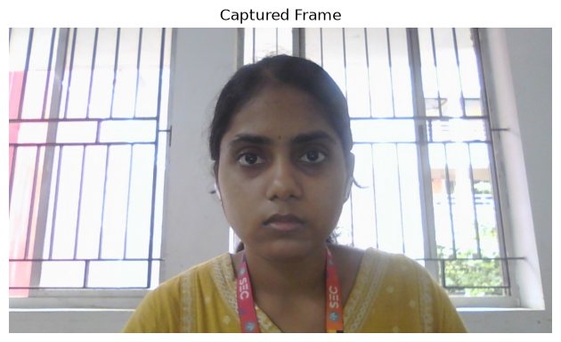
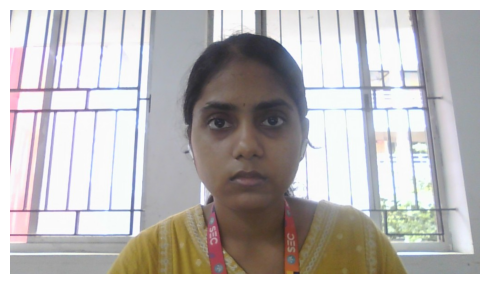
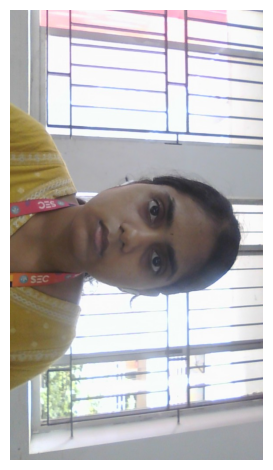

# EXP-2: Image Acquisition using Web Camera

## Experiment Details

- **Name:** Ramitha Chowdary S
- **Register Number:** 212224240130

## Aim

Write a Python program with OpenCV that takes a picture from the webcam and then:

1. Save that frame as a jpg.
2. Show the video.
3. Show the video again in a smaller window.
4. Rotate the video and show it.

## Software Required

- Anaconda
- Python 3
- Jupyter Notebook
- OpenCV
- Matplotlib

## Algorithm

**Step 1:** Open the webcam.

**Step 2:** Read one frame and save it as a jpg.

**Step 3:** Read the jpg back and display it.

**Step 4:** Read frames in a loop and show them one by one.

**Step 5:** Show the frames again inside a smaller figure.

**Step 6:** Turn each frame 90 degrees clockwise and display it.

**Step 7:** Release the webcam when the loop is done.

## Program

#### 1. Import the libraries

```python
import cv2
import matplotlib.pyplot as plt
from IPython.display import clear_output
import time
```

#### 2. Grab one frame and save it

```python
cam = cv2.VideoCapture(0)
ok, frame = cam.read()
if ok:
    cv2.imwrite("captured_frame.jpg", frame)
cam.release()
```

#### 3. Read the saved frame

```python
saved = cv2.imread("captured_frame.jpg")
```

#### 4. Display the captured frame

```python
plt.imshow(saved[:, :, ::-1])
plt.title("Captured Frame")
plt.axis("off")
plt.show()
```

#### 5. Show the video

```python
cam = cv2.VideoCapture(0)
for n in range(30):
    ok, frame = cam.read()
    if not ok:
        break
    rgb = cv2.cvtColor(frame, cv2.COLOR_BGR2RGB)
    clear_output(wait=True)
    plt.imshow(rgb)
    plt.axis("off")
    plt.show()
    time.sleep(0.05)
cam.release()
```

#### 6. Show it in a smaller window

```python
cam = cv2.VideoCapture(0)
for n in range(30):
    ok, frame = cam.read()
    if not ok:
        break
    rgb = cv2.cvtColor(frame, cv2.COLOR_BGR2RGB)
    clear_output(wait=True)
    plt.figure(figsize=(5, 3))
    plt.imshow(rgb)
    plt.axis("off")
    plt.show()
    time.sleep(0.05)
cam.release()
```

#### 7. Rotate the video and show it

```python
cam = cv2.VideoCapture(0)
for n in range(30):
    ok, frame = cam.read()
    if not ok:
        break
    turned = cv2.rotate(frame, cv2.ROTATE_90_CLOCKWISE)
    rgb = cv2.cvtColor(turned, cv2.COLOR_BGR2RGB)
    clear_output(wait=True)
    plt.imshow(rgb)
    plt.axis("off")
    plt.show()
    time.sleep(0.05)
cam.release()
```

## Output

### i) Saved frame



### ii) Video


### iii) Smaller window



### iv) Rotated video



## Result

The webcam frame was saved as a jpg. The video was shown, shown again in a smaller window, and rotated.
